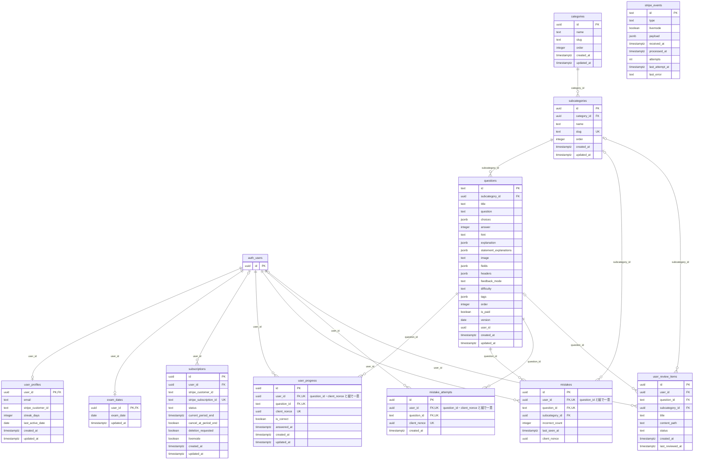
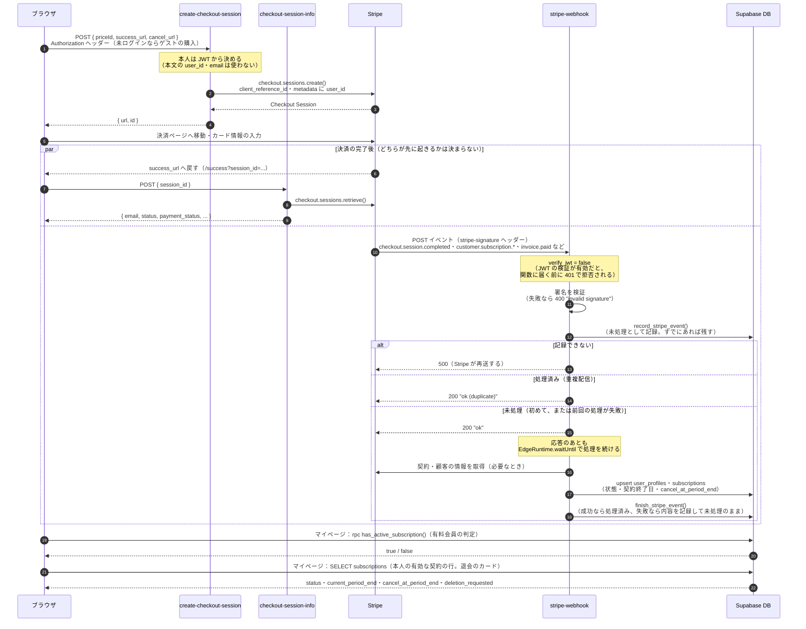

# 詳細設計（DB・設計判断）

[← README に戻る](../README.md)

## ER図（DBスキーマ）

> 本番の DB（2026年10月2日時点）の public スキーマの全テーブルと、外部キーの参照先の `auth.users`（Supabase の認証のテーブル。id の列だけを示す）です。PK は主キー、FK は外部キー、UK は一意の制約・一意の索引です。条件つきの一意の索引（`WHERE` 付き）と、ビューは図に含めていません。

## シーケンス図（決済〜Webhook同期）

## 設計判断のハイライト

### ① サブスクリプション契約履歴の保持設計

**改善前**
`subscriptions`テーブルは`user_id`にUNIQUE制約を持つ設計だった。1ユーザーにつき常に1行のみを保持する構造。

**改善後**
UNIQUE制約を`user_id`から`stripe_subscription_id`に変更。1ユーザーが複数のサブスクリプション行を持てる構造にした。

**理由**
`user_id`にUNIQUE制約がある設計では、ユーザーが解約後に再契約した場合、Stripeの新しいサブスクリプションIDを受け取っても既存の1行を上書きするしかなく、過去の契約履歴（いつ解約し、いつ再契約したか）が失われる。将来的な問い合わせ対応や解約率の分析に必要な情報が構造上残せない設計だった。制約の対象を`stripe_subscription_id`に変えることで、Stripe側の実際の契約単位とDB側の行が1対1に対応し、履歴が自然に蓄積される設計に改めた。

### ② Stripe Webhookの冪等性チェック

**改善前**
Stripeから送信されるWebhookイベントを受信する`stripe-webhook`関数側に、イベントの重複処理を防ぐ仕組みがなかった。

**改善後**
`stripe_events`テーブルを追加し、受信したイベントIDを主キーとして記録。署名検証の後にこのテーブルで同じイベントIDを探し、既にある場合（重複配信）は後続の更新処理をスキップする。ない場合はイベントを記録してから、更新処理をバックグラウンドで実行する。（2026-10-11 に欠陥が見つかり、下の「見つかった欠陥と、段階的な対応」のとおり作り直している）

**理由**
Stripeの公式仕様では、Webhookは「少なくとも1回」配信されることが保証されているが、「ちょうど1回」は保証されていない。ネットワーク遅延やタイムアウトにより、同一イベントが複数回配信されるケースが実際に発生しうる。冪等性チェックがない場合、サブスクリプションの状態更新処理が同じイベントに対して複数回走り、`current_period_end`の不整合といった実害につながる。`stripe_events`テーブルをイベントIDの記録台帳として使うことで、Stripeの再送による二重処理を防いだ。ただし、作り直す前の作りでは、確認と記録は別の命令で、記録に失敗しても処理を続けていた。そのため、同じイベントがほぼ同時に2回届いた場合は両方が処理されえた（主キーの制約で弾く作りではなかった）。

**見つかった欠陥と、段階的な対応（2026-10-11〜）**
E2E の実行中に、ローカルの DB への書き込みが一時的に失敗（502）し、契約の通知が反映されなかった。原因は作りにあった。処理の前に「記録済み」として `stripe_events` に書き、処理の結果を待たずに 200 を返すため、処理が失敗しても Stripe は再送せず、再送されても重複として飛ばされる。一時的な失敗が1回起きるだけで、その通知は反映されないまま残る。本番の記録では、契約の通知に対応する `subscriptions` の行はすべてあり、契約の状態（`status`）も最新の通知と一致していた（2026-10-11 確認）。

Stripe の勧め（すぐに 2xx を返し、処理は非同期の列で行う。重複の判定は処理済みの通知に限る）と、Supabase が示す構成（DB の列と `pg_cron`・`pg_net` による処理し直し）に沿って、次の順で直す。

1. `stripe_events` に、処理済みの時刻・試みた回数・最後の失敗の内容の列を足す（`20261010201500_stripe_events_processing_state.sql`）。済み
2. 受け取ったら未処理として記録して 200 を返し、処理を終えたら処理済みにする。失敗は記録して未処理のまま残す。重複の判定は処理済みの通知に限る。記録できなければ 500 を返す。記録と結果は DB の関数（`record_stripe_event()`・`finish_stripe_event()`）で行い、流れは `receive.ts`（今は `_shared/stripe-events/receive.ts`）に切り出して、失敗の場合を Deno.test で確かめる。済み
   - 処理の中で、DB の読み込みの失敗を「見つからない」として扱っていた箇所（会員の特定、退会の予約の確認）と、アカウントの削除の失敗をログに出すだけだった箇所も、失敗として扱うようにした。どれも、失敗したのに処理済みになり、通知が反映されないまま残る原因になるため
   - 同じ通知が処理の途中に再送されると、両方が処理することがある。書き込みは何度行っても結果が同じ（upsert）ため、データは正しいまま
   - 段階1で、変更の前のコードが足す行も処理済みになるよう `processed_at` に付けていた既定値（`now()`）は、段階2を本番に出した後に外した（`20261011193000_stripe_events_processed_at_no_default.sql`）。既定値が残ると、`processed_at` を指定せずに足した行が、処理していないのに処理済みになるため。済み
3. 契約の通知は、通知の中身ではなく、Stripe から最新の契約を取得して反映する（届く順番に頼らない）。済み
   - `customer.subscription.created`・`updated`・`deleted` で、`stripe.subscriptions.retrieve` で取り直した契約を同期と退会の判定に使う。`checkout.session.completed` と請求書の通知は、もともと取り直していた。解約済みの契約も ID で取り出せることを、本番の解約済みの契約2件で確かめた（2026-10-12、Stripe の Workbench の API Explorer で読み取りのみ）
   - E2E では、Stripe の代わりに偽の Stripe API（`e2e/fake-stripe-server.mjs`）に取りに行く。宛先は環境変数 `STRIPE_API_BASE_URL`（手元と CI だけ。stripe-node の公式の設定 `host`・`port`・`protocol` に変える。本番の鍵と一緒に設定されていたら止める）。Stripe 公式の stripe-mock は、登録した中身を ID で返さず、最新の API の版にしか対応しないため使わない
4. 未処理の通知を定期的に処理し直し、残ったら知らせる。済み
   - Supabase の公式の文書「Scheduling Edge Functions」の構成で、`pg_cron` が10分ごとに `pg_net` で Edge Function の `stripe-events-retry` を呼ぶ。URL と鍵は Vault に置き、呼ぶときに読む（`20261013120000_stripe_events_retry.sql`）
   - 処理し直すのは、未処理で、受け取ってから10分以上たった通知（処理は最長400秒で打ち切られるため、処理の途中のものを含まない）。前回の試みから10・20・40・80分と間隔を広げ、最大5回まで（Stripe の再送と同じく、間隔を広げる形）
   - 受け取ってから3時間たっても未処理の通知があれば、Better Stack の Heartbeat に失敗（`/fail`）を送り、メールで知らせる。毎回の終わりに Heartbeat を送るため、ジョブや関数が止まった場合も、届かないことで知らせが出る
   - 関数の呼び出しは、新しい形式の秘密の鍵（`apikey` ヘッダー）を `@supabase/server` の `withSupabase({ auth: 'secret' })` で確かめる（公式の文書「Securing Edge Functions」）。決済の通知を受ける `stripe-webhook` とは別の関数にし、処理し直しの不具合が通知の受け取りを止めないようにした。処理の中身は `_shared/stripe-events/` に移して共通にした

### ③ mistakesテーブルの不変性保護

**改善前**
`mistakes`テーブルには`(user_id, question_id)`にUNIQUE制約（`uq_mistakes_user_question`）があり、1ユーザー・1問題につき1行のみが対応する設計だった。しかし、この行の同一性を担保する`user_id`・`question_id`・`client_nonce`をDBレベルでUPDATEから保護する仕組みがなく、アプリケーション側の実装次第で、既存の`mistakes`行がまったく別のユーザー・別の問題を指すよう書き換えられてしまう余地があった。

**改善後**
`BEFORE UPDATE`トリガー`trg_mistakes_protect_immutable`を追加。`user_id`・`question_id`・`client_nonce`のいずれかが変更されようとした場合に例外を投げ、UPDATE自体を拒否するようにした。

**理由**
`mistakes`の各行は「このユーザーがこの問題を間違えた」という事実そのものを表しており、`user_id`・`question_id`はその行のアイデンティティに相当する。誤答の記録・解除は`INSERT`・`DELETE`で行うべきものであり、これらのカラムを`UPDATE`で書き換える正当な業務要件は存在しない。アプリケーション側のバグ（例えば誤ったUPSERT処理）が発生した場合、DB側に保護がなければ既存の誤答記録が別ユーザー・別問題のものとして静かに上書きされ、学習履歴の整合性が壊れるリスクがあった。DBレベルで不変性を強制することで、アプリケーション側の実装ミスに依存しない構造的な保護にした。

### ④ 退会フローにおけるデータ整合性の統一

**改善前**
`mistakes`テーブルに論理削除用の`deleted_at`カラムが存在する一方、`user_progress`等の関連テーブルには論理削除の仕組みがなく、FKにも`ON DELETE CASCADE`が設定されていなかった。ユーザーが退会（`auth.users`からの削除）しても、`mistakes`は論理削除フラグが立つのみで物理的には残り、他の関連テーブルはFKの削除ルールが未設定のため、退会したはずのユーザーのデータが複数のテーブルに残り続ける状態だった。

**改善後**
`mistakes`から論理削除用インフラ（`deleted_at`等）を撤去し、`mistakes`・`mistake_attempts`・`user_review_items`・`user_progress`・`exam_dates`・`user_profiles`等、ユーザーの個人情報そのものを含むテーブルのFKに`ON DELETE CASCADE`を統一して設定した。一方`subscriptions`のみ`ON DELETE SET NULL`とし、`user_id`を切り離しつつ契約記録自体は残す設計にした（①で守った契約履歴が、退会によって消えてしまわないようにするため）。

**理由**
論理削除と物理削除（CASCADE）が1つのテーブル群の中に混在すると、「退会済みユーザーのデータがどこまで残っているか」をテーブルごとに個別に把握しないと判断できず、削除漏れの温床になる。乙4のような学習データサービスでは、退会後もユーザーの誤答履歴等が特定の個人と紐づいた形でDBに残り続けることは、プライバシー・個人情報保護の観点で放置できないリスクである。削除ルールをFKレベルで統一したことで、「`auth.users`から消せば、個人情報テーブルは物理削除され、契約記録は匿名化されて残る」という単一の保証をDB構造そのものに持たせ、アプリケーション側の削除処理漏れに依存しない設計にした。

### ⑤ 問題データの3段階アクセス制御

練習問題データは、認証状態とRLSによって3段階に分かれている。

| 段階 | 問題数 | 保存場所 | 条件 |
|---|---|---|---|
| 無料体験 | 32問 | 静的データ（アプリに同梱、DBを介さない） | 認証不要 |
| 無料会員 | 100問 | `questions`テーブル（`is_paid = false`） | メール登録（登録と同時にログインした状態になる。RLSでログイン済みユーザーのみ読み取り可） |
| 有料会員 | 約1,473問 | `questions`テーブル（`is_paid = true`） | 有効なサブスクリプション必須（RLS の関数 `has_active_subscription` で判定。下の「⑦ 有料会員の判定」参照） |

全1,573問のうち無料は100問（約6%）にとどめ、残りを有料の壁の奥に置くことで、検索流入で評価を得ている法令・物理化学の解説ページ（`/basics`配下、認証不要）と、収益化対象の練習問題との間でバランスを取っている。

### ⑥ DB の権限の設計

ブラウザから届く要求には読み取りだけを許し、書き込みは本人の行だけを書く関数に限っている。

| ロール | テーブル・ビュー | 関数の実行 |
|---|---|---|
| `anon`（ログインなし） | 権限なし | 権限なし |
| `authenticated`（ログイン済み） | `SELECT` のみ（読める行は RLS で決める） | 書き込みの関数6つ、読み取りの関数3つ |

- 書き込みの関数（`add_review_item`・`clear_mistake`・`mark_review_item_mastered`・`record_mistake`・`record_progress`・`set_exam_date`）は `SECURITY DEFINER`。ユーザー ID を引数で受け取らず、関数の中で `auth.uid()` を使って本人を決める
- 読み取りの関数（`get_study_days`・`pick_next_question`・`has_active_subscription`）もユーザー ID を引数で受け取らず、`SECURITY INVOKER` で RLS を通る

**理由**
ユーザー ID を引数で受け取る関数は、ID を知っていれば他人の情報を確かめられる作りだった（`has_active_subscription`）。読み書きのすべての関数を `auth.uid()` に統一し（PR #45・#60・#61）、使われていない関数・ポリシーと `anon` の権限を外した（PR #58）。これにより、クライアントが DB に書き込める経路は6つの関数だけになった。

**検証**
権限は pgTAP で確かめ、CI で PR ごとに実行している。ロールの権限を確かめるテストが10ファイル（`public_no_client_write_privileges` など）。関数が本人の記録だけを使うことは、`get_study_days()` が本人の学習日だけを返すこと（`study_days_own_only`）と、`pick_next_question` が本人の解答の記録で次の問題を選ぶこと（`next_question_own_progress`）で確かめている。あわせて、public の関数がすべて search_path を固定していること（`public_functions_fixed_search_path`）も確かめている。

### ⑦ 有料会員の判定

**対応前**：有料会員かどうかの判定が4か所に書かれており、条件は2通りあった。

| 場所 | 参照する表 | 条件 | 用途 |
|---|---|---|---|
| RLS の関数 `has_active_subscription` | `user_profiles` | 契約終了日が「現在 − 60秒」より後、または状態が `active`・`trialing`・`past_due` | 有料の問題の読み取り |
| `src/lib/subscription.ts` の `isSubscribed()` | `user_profiles` | 上と同じ | マイページの表示など |
| `src/components/SiteHeader.tsx` | `subscriptions` の最新の1行（取れなければ `user_profiles`） | 状態が `active`・`trialing`・`past_due`（契約終了日は見ない） | ヘッダーの「購入」「請求情報」の出し分け |
| `src/app/mypage/WithdrawalCard.tsx` | `subscriptions` の最新の1行 | 状態が `active`・`trialing`・`past_due`（契約終了日は見ない） | 退会の手続きの出し分け |

- 同じ条件を SQL と TypeScript で別々に書いていたため、片方だけ直すとずれる状態だった
- `has_active_subscription` は引数でユーザー ID を受け取り、`anon` にも実行を許可していた。ID を知っていれば、他人が有料会員かどうかを確かめられた
- ヘッダーと退会のカードは契約終了日を見ないため、有料の問題を読めるかどうかと、画面の出し分けが食い違う場合があった

**対応**：

- `has_active_subscription` を、引数を取らずに `auth.uid()` で本人だけを判定する関数に作り直し、`anon` の実行権限を外した（PR #45）
- 判定の条件を「`subscriptions` の本人の行のどれかの状態が `active`・`trialing`・`past_due`」に一本化し、契約終了日の条件は外した。Stripe は「期間の終わりに解約」を選んだ契約を期間の終わりまで `active` のまま保つため、使える期間は変わらない。一方で、即時に解約された契約（`canceled`）が契約終了日まで有料のまま残る状態はなくなった（PR #51）
- 画面側の `isSubscribed()` とヘッダーは、この関数を呼ぶだけにした（PR #52）
- `user_profiles` の契約の情報の列（`subscription_status`・`current_period_end`）は、Edge Functions からの書き込みをやめ、本番で Webhook の書き込みが成功することを確かめてから削除した（PR #53・#54）
- 切り替えの前後で、本番の全利用者の判定が変わらないことを確かめた

今の使われ方：

| 使う場所 | 用途 |
|---|---|
| `questions` の RLS のポリシー `read_paid_questions_with_subscription` | 有料の問題の読み取り |
| 関数 `add_review_item`・`record_progress`・`record_mistake` | 有料の問題の復習リストへの追加、解答と誤答の記録 |
| `src/lib/subscription.ts` の `isSubscribed()`（rpc で呼ぶ） | マイページの表示、次の問題の選び方、ヘッダーの「購入」「請求情報」の出し分け |

**退会の流れ**：`src/app/mypage/WithdrawalCard.tsx` と Edge Function `request-account-deletion`・`cancel-account-deletion` は、退会予約の印（`deletion_requested`）を付ける契約の行を決める必要があるため、関数ではなく契約の行そのものを読む。以前は本人の行のうち**一番新しく更新された1行**を見ていたため、解約した古い契約と再契約した新しい契約の2行を持つ利用者で、古い行が後から更新されると（Webhook のイベントが遅れて届いた場合など）、有料会員を無料会員として即時削除しうる作りだった。対象を「状態が `active`・`trialing`・`past_due` の行のうち、一番新しく更新された1行。該当する行がなければ無料会員」に変え、`has_active_subscription` と同じ考え方にそろえた（PR #56）。

**あわせて廃止したもの**：

- ビュー `user_active_subscriptions`（`subscriptions` の状態が `active`、かつ契約終了日が空または未来）は、メールアドレス未確認のユーザーを削除する関数だけが使っていた。関数を廃止して使われなくなったため、削除した（`supabase/migrations/20260928072508_drop_user_active_subscriptions_view.sql`）
- メールアドレス未確認のユーザーを削除する定期実行（`daily_unverified_cleanup`）は、本番にだけ登録されていた。関数の中で呼んでいた削除の命令（`auth.delete_user`）が存在せず、2025-09-02 の開始から一度も削除できていなかった（2026-02-21 以降は毎日失敗）。登録から確認済みになる今の設計では対象が生まれないため、関数とともに廃止した（`supabase/migrations/20260928061907_remove_unverified_cleanup.sql`）

## 型安全性

**対応済み**：`check-guest-subscription`・`stripe-webhook`にあった3箇所の`as any`を解消した。契約終了日の解決部分（2箇所）は、範囲を`PeriodEndSource`型に限定したアサーション（`as unknown as PeriodEndSource`）に変更し、その後 SDK を API の版に合わせたことで、アサーションも不要になった（下記）。顧客のメールアドレス取得部分（`stripe-webhook`）は、`"deleted" in cust`による型の絞り込みに変更し、キャスト自体を排除した。

原因はStripeが2025-03-31のBasil APIバージョンで`Subscription`直下の`current_period_end`を廃止し`items.data[].current_period_end`に移行したこと。2026-10-12 まで、Edge Functions は Basil 以前の API バージョン（2024-06-20、`esm.sh` の `stripe@14`）で Stripe の API を呼んでいた。一方、アカウントと Webhook の送信先の API バージョンは `2025-05-28.basil` で、届く通知は Basil の形だった。読み込む型定義は Basil 以降の形を反映しており、型と実行時の値がずれていた。

**SDK を API の版に合わせて解消（2026-10-12）**：5つの Edge Functions の Stripe の SDK を、`esm.sh` の `stripe@14`（`2024-06-20`）から、アカウントと Webhook の送信先の版に合う `npm:stripe@18.2.1`（`2025-05-28.basil` に固定）に変えた。読み込みは Supabase の公式の例と同じ `npm:` の形にし、Webhook の署名の確認には `Stripe.createSubtleCryptoProvider()`（Web Crypto）を渡す。型と実行時の値が一致したため、`as unknown as PeriodEndSource` をやめた。実行時のスキーマ検証（`zod` 等）は行っていない。

**同じずれで見落としていた欠陥**：請求書の通知（`invoice.paid`・`invoice.payment_succeeded`）の処理は、Basil でなくなった `invoice.subscription` を読んでいたため、本番に届いた13件はどれも契約を同期していなかった（2026-10-12 に本番の `stripe_events` で確認）。月次更新の請求書10件には、どれも2時間以内に同じ契約の `customer.subscription.updated` が届いており、契約終了日はそちらの通知で反映されていた。データの欠けは見つかっていない。請求書の `parent.subscription_details.subscription` から契約を特定するように直した（`invoice.ts`、今は `_shared/stripe-events/invoice.ts`。Deno.test で、直す前の作りでは失敗することを確かめた）。

**Edge Functions の型の検査**：CI の `Deno.test` が型を検査するのは、テストと、テストが読み込むファイル（判定の関数を切り出した `decision.ts` など）だけで、Stripe の呼び出しや DB への書き込みがある各関数の `index.ts` は型の検査の対象外だった。CI に `deno check` を加え、7つの `index.ts` を PR ごとに検査するようにした。最初の検査で見つかった19件は、引数の型の書き忘れ（15件）、型の推論の失敗（3件。実行時の値は正しく、本番の `subscriptions` に契約の ID が空の行がないことも確認）、`EdgeRuntime` が見つからない（1件）で、いずれも動きを変えずに直した。`EdgeRuntime` は、Supabase の型定義（`edge-runtime.d.ts`）を JSR から読み込むと宣言がグローバルにならないことを、最小の再現で確かめたうえで、型だけを取り出して使う形にした。
